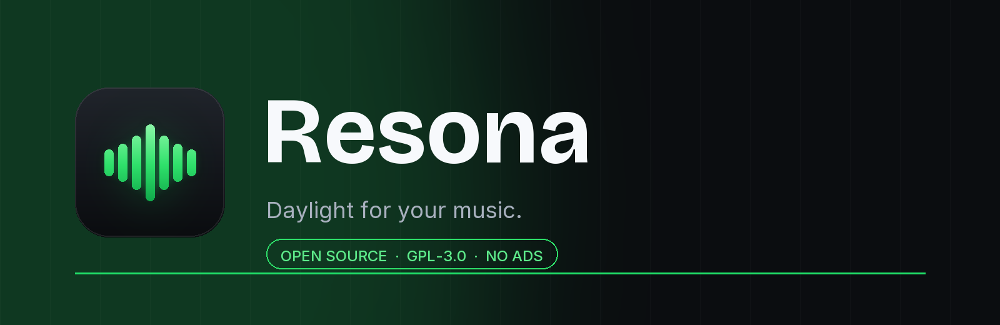

<div align="center">


# Resona

**Daylight for your music.**

A calm, cool-grey Flutter music player with synced lyrics, a local taste profile,
Spotify import, offline listening, and no ads.

[](LICENSE)
[](https://flutter.dev)
[](https://github.com/carlsibug98-spec/musify)

</div>

---

## Highlights

- **Daylight interface** — cool-grey grounds, Bricolage Grotesque titles, Inter UI,
  circular artwork, floating cards, and a single accent colour you can change.
- **Synced lyrics** — a tall scrolling lyric sheet with tap-to-seek, instrumental
  sections marked with quiet note glyphs, and a sleep timer beside share and queue.
- **A home feed that learns** — artist picks, likes, qualified plays, recents, and
  skips shape a local taste profile. The "Because you like …" shelf can hide a
  section or a song and undo it from the toast.
- **Unified detail pages** — albums, playlists, and artists share one action row,
  with a large play button, shuffle, like, download, and share.
- **Spotify import** — paste a playlist or album share link and Resona matches the
  tracks on YouTube, then builds the playlist with cover art.
- **Offline and local** — downloads, local files, custom playlists, a built-in
  equalizer, SponsorBlock, listening recaps, and 21 languages.
- **No ads. No subscriptions.**

## Build

Resona is a Flutter app. You need Flutter 3.x, the Android SDK, and JDK 17+.

```bash
flutter pub get
flutter gen-l10n
flutter build apk --release --flavor github --target-platform android-arm64
```

The debug build used during design verification:

```bash
flutter build apk --debug --flavor github --no-pub --target-platform android-arm64
```

Desktop targets live in `windows/` and `linux/`.

## Brand

The Resona mark is a seven-bar resonance waveform: the same visual language as the
Resona desktop app, re-graded for Daylight. The launcher icon, adaptive foreground,
monochrome themed icon, Windows ICO, and README banner are reproducible:

```bash
python scripts/generate_brand_assets.py
```

Brand assets live in [`docs/brand/`](docs/brand/). The in-app wordmark uses
Bricolage Grotesque; the compact five-bar mark is drawn in
`DaylightBrandMark` so it stays crisp at 20–22 px.

## Credits

Resona is an independent, GPL-3.0 rebrand of
[Musify](https://github.com/gokadzev/Musify) by
[Valeri Gokadze](https://github.com/gokadzev). The original copyright notices and
GPL-3.0 headers are preserved throughout the source tree. The Daylight redesign,
interest-driven home, unified detail pages, and Resona branding are the changes in
this fork.

Spotify is a trademark of Spotify AB. Resona is not affiliated with Spotify.

## License

Resona is free software under the GNU General Public License v3.0. You may use,
modify, and distribute it under the same license, provided you keep the source open,
retain all copyright notices, disclose changes, and preserve the GPL-3.0 terms.

See [LICENSE](LICENSE) for the full text.
